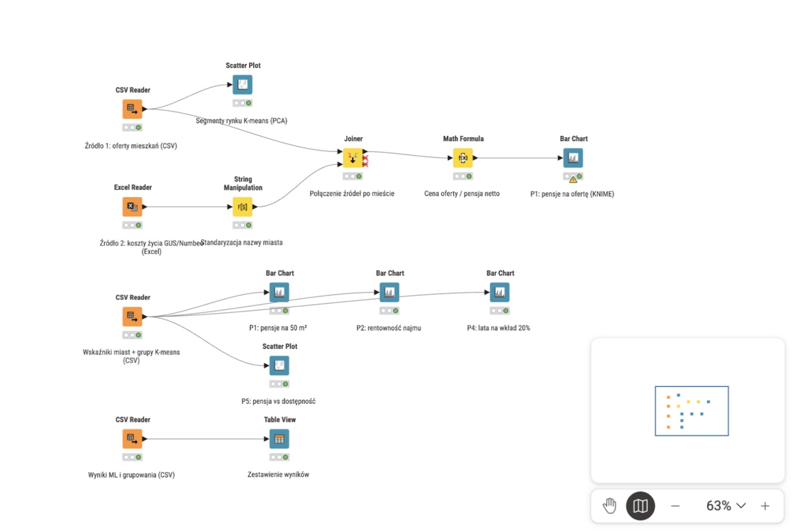
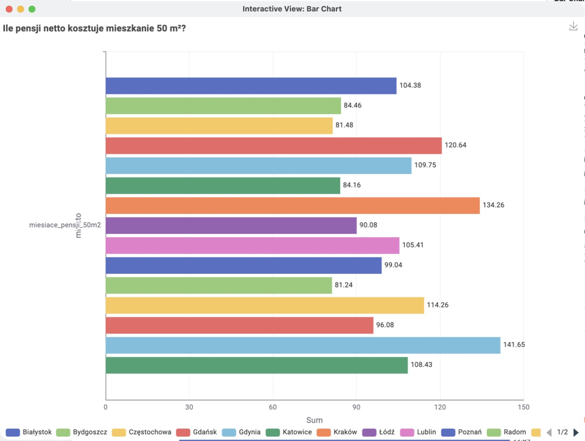
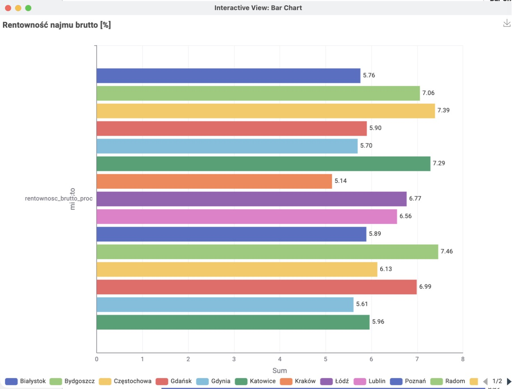
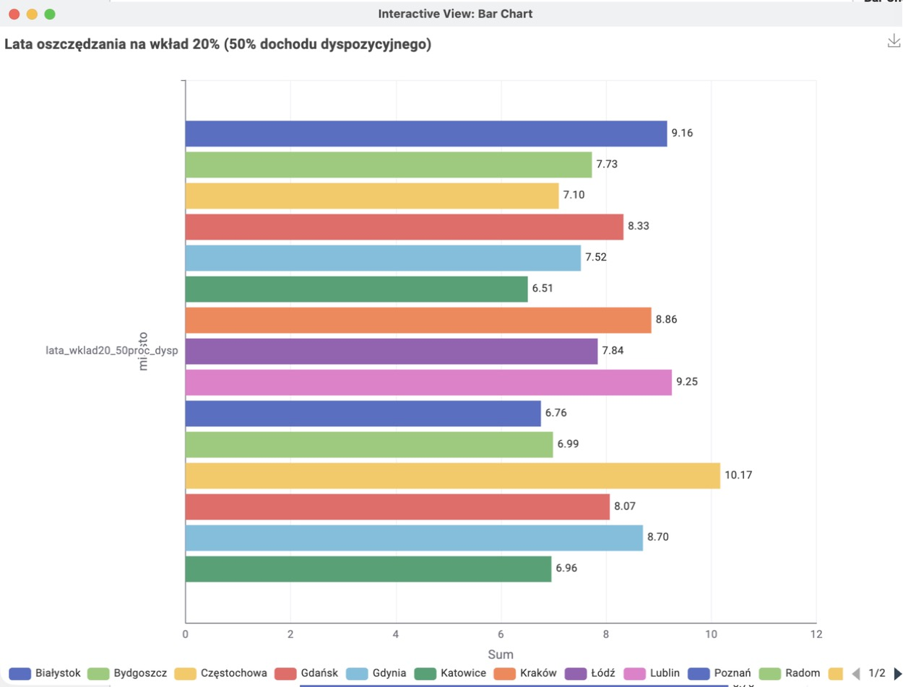
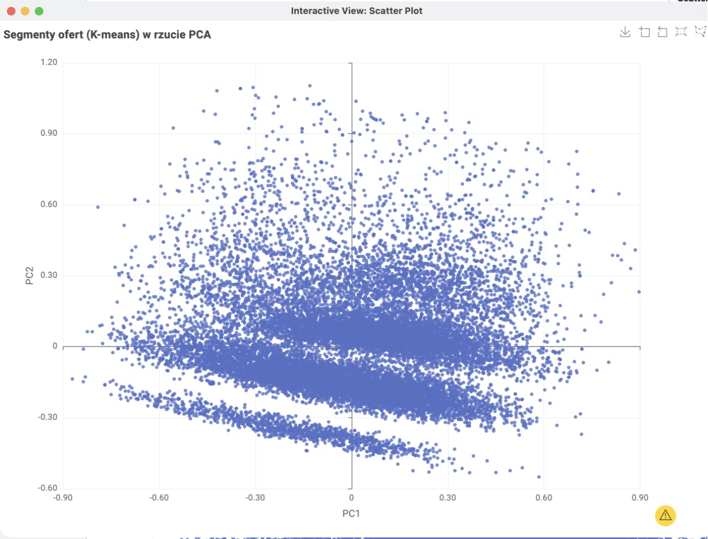
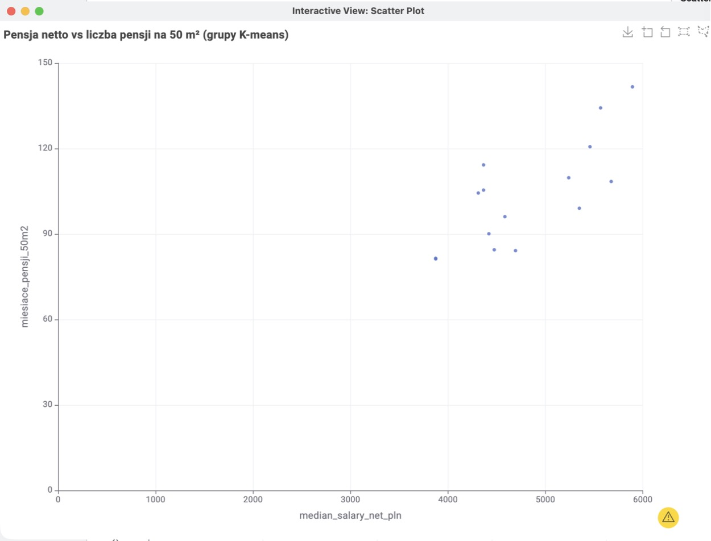
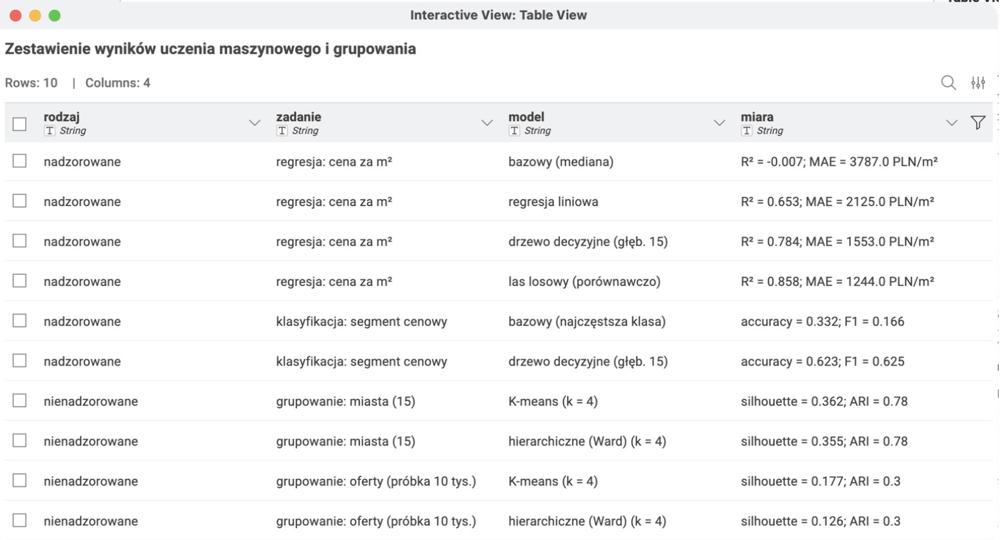

# Wizualizacja w KNIME Analytics Platform

Etap 7 projektu: *import danych z minimum dwóch różnych źródeł, zestawienie wyników algorytmów uczenia maszynowego i grupowania, wizualizacja wyników w formie wykresów* — platforma **KNIME Analytics Platform 5.12**.

## Gotowy workflow

| Plik | Opis |
|---|---|
| `dostepnosc_mieszkan.knwf` | wyeksportowany workflow (z danymi i wykonanymi węzłami) — do oddania / importu |
| `dostepnosc_mieszkan/` | ten sam workflow jako folder |
| `data/` | dane wejściowe (generuje je notebook `07_wizualizacja_i_prezentacja.ipynb`) |

**Otwarcie:** w KNIME *File → Import KNIME Workflow…* → wybierz `dostepnosc_mieszkan.knwf` (albo przeciągnij plik do okna KNIME). Workflow jest już wykonany — widok każdego wykresu otwiera się przez kliknięcie węzła (*Open view* / F10). Dane są w folderze danych workflow, więc działa na każdym komputerze bez zmiany ścieżek.

## Struktura workflow (14 węzłów, wszystkie wykonane)

```
[CSV Reader: oferty (źródło 1)]──┬───────────────[Joiner city = miasto_klucz]──[Math Formula]──[Bar Chart P1]
                                 └─[Scatter Plot: segmenty K-means w rzucie PCA]      ▲
[Excel Reader: koszty życia (źródło 2)]──[String Manipulation: klucz miasta]─────────┘

[CSV Reader: wskaźniki miast]──┬─[Bar Chart: pensje na 50 m²]          (P1)
                               ├─[Bar Chart: rentowność najmu]         (P2)
                               ├─[Bar Chart: lata na wkład 20%]        (P4)
                               └─[Scatter Plot: pensja vs dostępność, kolor = grupa K-means] (P5)

[CSV Reader: wyniki ML i grupowania]──[Table View: zestawienie wyników]
```

| Węzeł | Rola |
|---|---|
| **CSV Reader** — `oferty_segmenty.csv` | źródło 1: 20 tys. ofert z ceną, cechami, segmentem K-means i składowymi PCA |
| **Excel Reader** — `koszty_zycia_miasta.xlsx`, arkusz `koszty_2024` | źródło 2: płace i koszty życia (GUS/Numbeo) |
| **String Manipulation** | standaryzacja klucza: `replace(removeDiacritic(lowerCase($city$)), "ł", "l")` → `Kraków` → `krakow` |
| **Joiner** | połączenie źródeł: `city` (oferty) = `miasto_klucz` (koszty życia), inner join |
| **Math Formula** | `$price$ / $median_salary_net_pln$` → `liczba_pensji_oferta` (ile pensji netto kosztuje oferta) |
| **Bar Chart** (×4) | P1 — średnia liczba pensji na ofertę (z połączonych źródeł) i pensje na 50 m²; P2 — rentowność najmu; P4 — lata zbierania na wkład |
| **Scatter Plot** (×2) | segmenty rynku K-means w rzucie PCA; pensja vs dostępność z kolorem grupy miast K-means |
| **Table View** | zestawienie metryk: drzewo decyzyjne (R², MAE, accuracy, F1), K-means/Ward (silhouette, ARI) |

## Zrzuty ekranu (KNIME 5.12, test 22.11.2026)

Workflow otwarty z *Local space* w KNIME Analytics Platform 5.12 — wszystkie 14 węzłów wykonanych (zielone światła).



**Bar Chart — P1: ile pensji netto kosztuje mieszkanie 50 m²**



**Bar Chart — P2: rentowność najmu brutto [%]**



**Bar Chart — P4: lata oszczędzania na wkład 20%**



**Scatter Plot — segmenty ofert w rzucie PCA (PC1 × PC2)**



**Scatter Plot — P5: pensja netto vs liczba pensji na 50 m²**



**Table View — zestawienie wyników uczenia maszynowego i grupowania**



### Uwagi z testu

- **Bar Chart „P1: pensje na ofertę (KNIME)”** (za Math Formula) — KNIME zgłasza *Invalid node settings*: w `settings.xml` jest `aggregationMethod = AVERAGE`, a wersja 5.12 przyjmuje tylko `NONE / COUNT / SUM / AVG`. Węzeł wraca do ustawień domyślnych, więc wykres nie pokazuje średniej liczby pensji na miasto (dlatego nie ma go na zrzutach). Poprawka: w konfiguracji ustawić *Category* = `city_label`, *Aggregation* = *Average*, *Frequency* = `liczba_pensji_oferta`.
- **Oba Scatter Ploty** są jednokolorowe: *Color dimension* (`segment_rynku`, `grupa_miast`) jest oznaczony jako *(Missing)*, bo widok koloruje tylko kolumny z przypisanymi kolorami. Poprawka: wstawić węzeł **Color Manager** przed każdym Scatter Plotem.

## Jak powstał

Workflow został wygenerowany i wykonany automatycznie (bez klikania) przez publiczne API KNIME: węzły utworzono programowo, ustawienia uzupełniono w plikach `settings.xml`, a całość wykonano w trybie bez interfejsu graficznego. Można go dowolnie edytować w KNIME jak każdy inny workflow.

## Ewentualne rozszerzenia w KNIME

- **Dashboard:** zaznacz węzły wykresów → prawy przycisk → *Create Component…* → w komponencie *Layout Editor* ułóż wykresy w siatce.
- **Odtworzenie algorytmów:** Normalizer → k-Means (k = 4) → Silhouette Coefficient na `miasta_wskazniki.csv`; Table Partitioner → Decision Tree Learner/Predictor → Scorer na połączonych ofertach.
