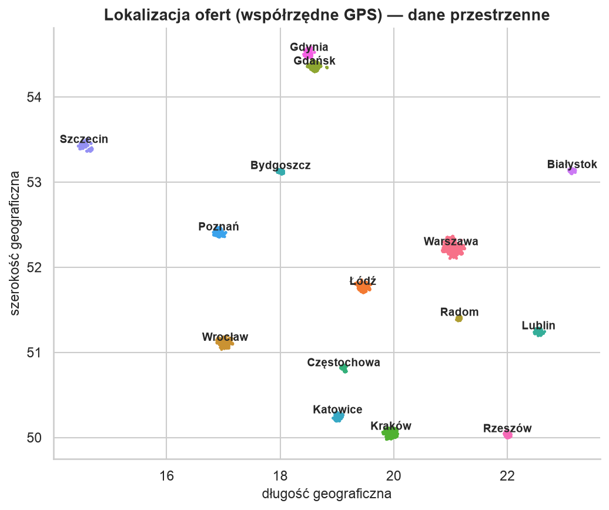
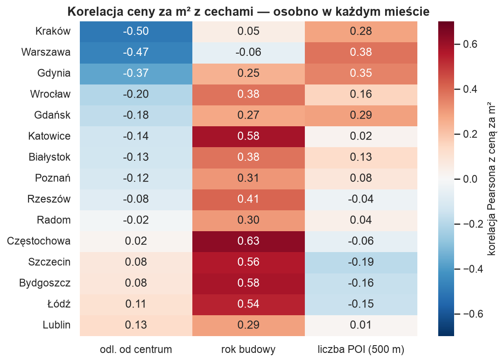
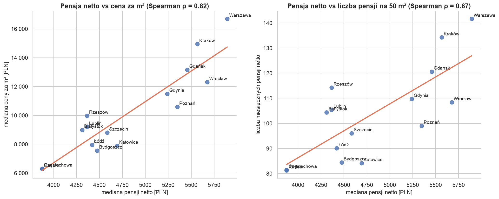
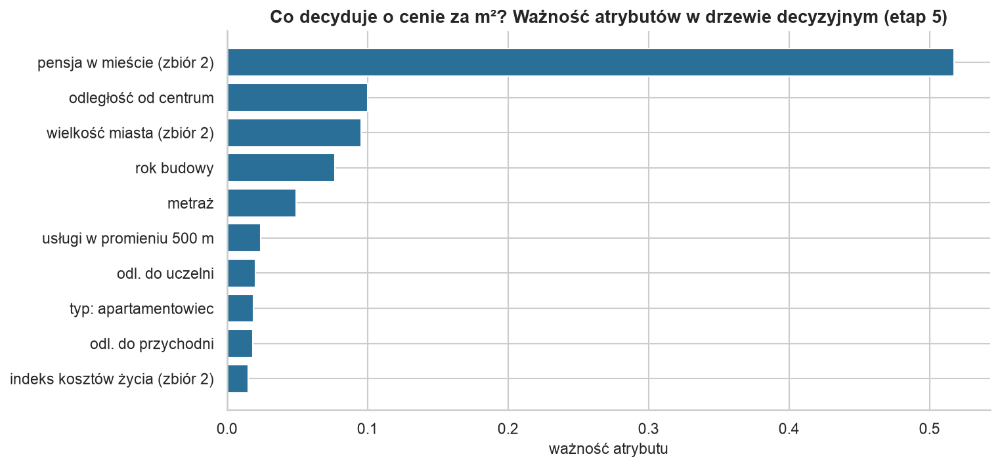
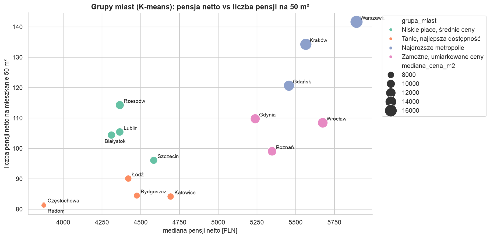
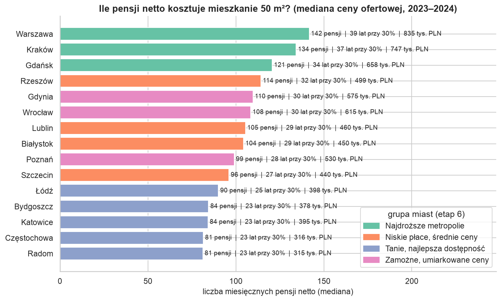
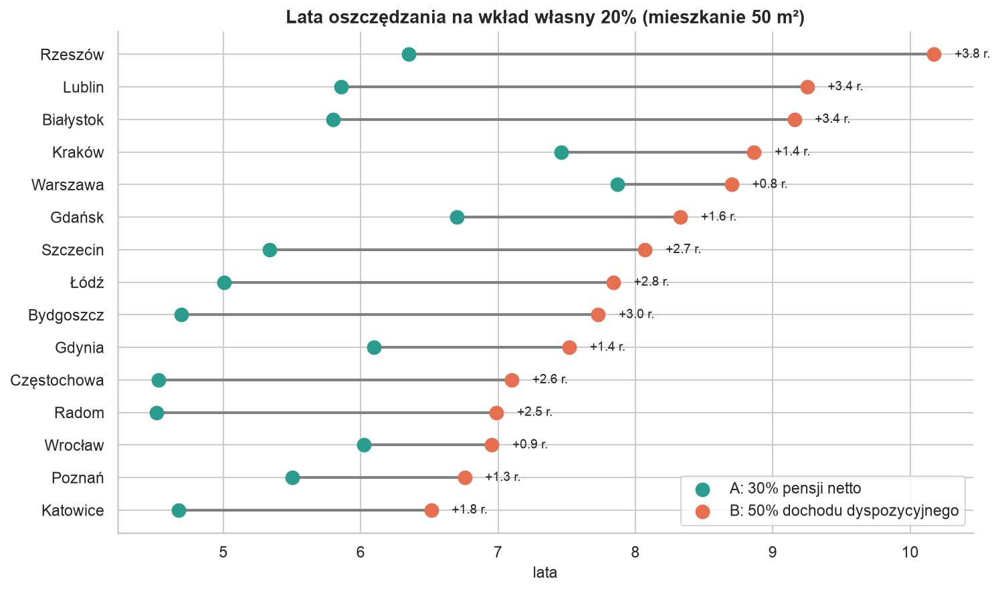
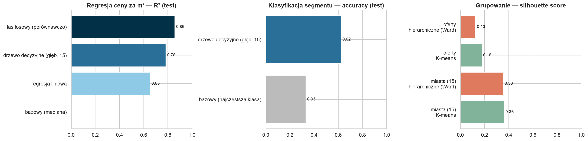

# Analiza dostępności cenowej mieszkań w największych miastach Polski w relacji do lokalnych wynagrodzeń i kosztów życia

**Przedmiot:** Metody analizy, przetwarzania i wizualizacji danych
**Prowadząca:** mgr Paulina Kuśmierz
**Autor:** Adrian Tusiński
**Narzędzia:** Python 3 (pandas, numpy, scikit-learn, scipy, matplotlib, seaborn), Jupyter, KNIME Analytics Platform

---

## 1. Temat, cel i źródła danych (etap 1)

**Cel analizy:** ocena realnej dostępności mieszkaniowej w 15 największych miastach Polski przez wyznaczenie wskaźników dochodowych (relacja ceny mieszkania do pensji, czas oszczędzania na wkład własny) oraz porównanie opłacalności zakupu i najmu. Sama cena za m² nie oddaje sytuacji mieszkańców bez kontekstu lokalnych zarobków i kosztów życia, dlatego łączymy dane z dwóch źródeł.

**Pytania analityczne:**

1. Ile miesięcznych pensji netto (lub lat oszczędzania 30% pensji) potrzeba na zakup mieszkania 50 m²?
2. W których miastach relacja czynszu do ceny jest najkorzystniejsza dla inwestora, a gdzie bardziej opłaca się wynajmować?
3. Jak odległość od centrum, rok budowy i infrastruktura w promieniu 500 m wpływają na cenę m²?
4. Jak zmienia się czas oszczędzania na wkład własny 20% po odjęciu od pensji kosztów życia?
5. Czy miasta o najwyższych zarobkach są względnie bardziej, czy mniej dostępne niż ośrodki regionalne?

**Źródła danych:**

| Zbiór | Źródło | Format | Zawartość |
|---|---|---|---|
| Apartment Prices in Poland | Kaggle — oferty z serwisów ogłoszeniowych + OpenStreetMap | 19 plików CSV (sprzedaż 08.2023–06.2024, najem 11.2023–06.2024) | 195,6 tys. wierszy sprzedaży, 70,8 tys. najmu, 28 atrybutów |
| Poland cost of living vs salary per city | Kaggle — dane GUS/BDL i Numbeo | 2 pliki CSV | 295 miast (2024) oraz szereg 2010–2024 dla 180 miast |

Dane mają charakter **tabularny** (strukturalny), **czasowy** (miesiąc oferty, rok płac) i **przestrzenny** (współrzędne GPS, odległość od centrum, miasto). Zbiory nie zawierają danych osobowych — identyfikator oferty jest skrótem (hash), a płace są zagregowane per miasto. Klucz integracji to nazwa miasta po standaryzacji (małe litery, bez polskich znaków); wszystkie 15 miast ofertowych ma odpowiednik w zbiorze 2.

## 2. Struktura danych i podstawowa analiza statystyczna (etap 2)

**Klasyfikacja atrybutów zbioru ofert (28):** 12 numerycznych ciągłych (powierzchnia, cena, współrzędne, odległości), 5 numerycznych dyskretnych (pokoje, piętro, liczba pięter, rok budowy, liczba POI), 5 kategorycznych nominalnych (miasto, typ zabudowy, własność, materiał, id), 1 porządkowy (stan wykończenia) i 5 binarnych (parking, balkon, winda, ochrona, komórka). Zbiór 2 zawiera 19 atrybutów, głównie numerycznych (kwoty w PLN, wskaźniki).

**Wspólne atrybuty i relacje:** `city` (klucz, relacja wiele-do-jednego: oferty → miasto), wymiar czasu (`period` ↔ `year`) i czynsz (oferty najmu ↔ czynsz 1-pokojowy w zbiorze 2). W zbiorze 2 nazwa miasta nie jest unikalna (np. Chrzanów w dwóch województwach), więc pełny klucz to (miasto, województwo).

**Statystyki:** rozkłady cen są prawostronnie skośne (skośność ceny 1,76), więc miarą typową jest mediana: 699 tys. PLN i 12 979 PLN/m² dla sprzedaży oraz 3 100 PLN/mies. dla najmu. Mediany cen za m² wahają się od ok. 6 300 PLN (Radom, Częstochowa) do 16 900 PLN (Warszawa).

**Paradoks Simpsona:** w całym zbiorze korelacja ceny za m² z odległością od centrum jest bliska zera, ale liczona osobno w każdym mieście jest wyraźnie ujemna w dużych miastach (Kraków −0,50, Warszawa −0,47). W mniejszych miastach cenę różnicuje głównie rok budowy (Częstochowa +0,63, Bydgoszcz +0,58).

**Imputacja:** porównano średnią, medianę, medianę w grupie i regresję dla `buildYear` (ukryto 20% znanych wartości). MAE: średnia 26,2 roku, mediana 25,9, regresja liniowa 19,1, las losowy **8,7 roku**. Metody stałe spłaszczają rozkład (odchylenie standardowe 0), a regresja odtwarza go najwierniej.

## 3. Przekształcanie i przygotowanie danych (etap 3)

| Krok | Sprzedaż | Najem |
|---|---|---|
| dane surowe | 195 568 | 70 847 |
| błędne wartości (≤10 m²/pokój, udział, czynsz < 500 PLN) | 195 537 | 70 758 |
| wartości odstające ceny za m² (IQR × 1,5 w każdym mieście) | 191 795 | 69 350 |
| deduplikacja (ta sama oferta w kolejnych miesiącach) | **91 292** | **37 250** |

- **Duplikaty:** ponad połowa wierszy to powtórzenia tych samych ofert w kolejnych miesiącach. Zostawiono ostatnią obserwację i dopisano historię (liczba miesięcy, zmiana ceny); 28% ofert widocznych dłużej niż miesiąc zmieniło cenę (mediana −3,1%).
- **Formaty:** standaryzacja nazw miast, `yes/no` → `1/0`.
- **Braki:** kategoria `brak_danych` dla stanu, materiału i typu (20–75% braków); regresja (las losowy) dla roku budowy; mediany w grupach dla pięter i odległości; reguła „≥ 5 pięter → winda”. Usunięcie wierszy z brakami skasowałoby 88% ofert.
- **Nowe atrybuty:** cena za m², wiek budynku, względne piętro, liczba udogodnień, indeks ceny względem miasta (100 = mediana miasta).
- **Dyskretyzacja:** segment cenowy (tercyle w mieście: tanie/średnie/drogie), strefa (centrum < 2 km, pośrednia 2–5 km, peryferia > 5 km), epoka budowy, wielkość mieszkania. Najdroższe są nowe mieszkania w centrum (indeks 138), najtańsze — starsze na peryferiach (indeks ~89).
- **Normalizacja Min-Max** atrybutów liczbowych do [0, 1] (zmienia skalę, nie kształt rozkładu).
- **Integracja:** tabela `miasta_wskazniki.csv` łączy mediany z ofert z płacami i kosztami życia oraz zawiera wskaźniki dostępności.
- **Wpływ jakości danych:** czyszczenie zmienia średnie cen o 0–7% (najwięcej w Gdyni i Krakowie), a mediany znacznie mniej, co potwierdza odporność mediany.

Wynik etapu zapisano w formacie CSV w `data/processed/`.

## 4. Korelacje i redukcja wymiarowości (etap 4)

**Metody korelacji (pandas):** Pearson (zależność liniowa), Spearman (monotoniczna, na rangach), Kendall (zgodność par, dla małych prób). Z indeksem ceny względem miasta najsilniej wiążą się: odległość od centrum (r = −0,27), winda (+0,23), liczba usług w promieniu 500 m (+0,21) i rok budowy (+0,17 do +0,20); większe mieszkania są tańsze za m² (−0,20 do −0,25). Pojedyncze korelacje są słabe, więc cenę trzeba modelować wielowymiarowo.

**Na poziomie miast (n = 15):** pensja netto jest bardzo silnie skorelowana z ceną za m² (r = 0,91), a także dodatnio z liczbą pensji potrzebnych na 50 m² (Spearman ρ = 0,67, p = 0,01). **Ceny rosną szybciej niż płace.** Rentowność najmu jest silnie ujemnie skorelowana z ceną (ρ = −0,90).

**PCA (scikit-learn, po standaryzacji 19 atrybutów):** 9 składowych wyjaśnia 83% wariancji (kryterium Kaisera: 6). PC1 (27%) to oddalenie od usług, PC2 (12%) to nowoczesny, wysoki budynek (winda, rok budowy, piętra), PC3 (10%) to wielkość mieszkania. **LDA** (porównawczo, nadzorowana) lepiej rozdziela segmenty cenowe, głównie dzięki odległości od centrum i rokowi budowy, choć segmenty wciąż się nakładają.

## 5. Uczenie maszynowe — drzewo decyzyjne (etap 5)

**Modele:** regresja ceny za m² (wycena oferty) i klasyfikacja segmentu cenowego (tanie/średnie/drogie w swoim mieście). Dane wejściowe łączą oba źródła: cechy oferty oraz płace, indeks kosztów życia i liczbę ludności miasta. Podział danych to 80/20 (warstwowany po mieście), a hiperparametry dobrano walidacją krzyżową 5-fold (GridSearchCV).

| Zadanie | Model | Wynik (zbiór testowy) |
|---|---|---|
| regresja | bazowy (mediana) | R² ≈ 0; MAE 3 787 PLN/m² |
| regresja | regresja liniowa | R² = 0,65; MAE 2 125 PLN/m² |
| regresja | **drzewo decyzyjne (głęb. 15)** | **R² = 0,78; MAE 1 553 PLN/m²; MAPE 11,8%** |
| regresja | las losowy (porównawczo) | R² = 0,86; MAE 1 244 PLN/m² |
| klasyfikacja | bazowy (najczęstsza klasa) | accuracy 0,33 |
| klasyfikacja | **drzewo decyzyjne (głęb. 15, entropia)** | **accuracy 0,62; F1 makro 0,62** |

Najważniejsze atrybuty drzewa regresyjnego to poziom płac w mieście, odległość od centrum, wielkość miasta, rok budowy i metraż. Drzewo o głębokości 3 daje czytelne reguły: bogate miasto → nowy budynek → blisko centrum. Wykres zależności od głębokości pokazuje przeuczenie: od głębokości ~12 dokładność na zbiorze uczącym dalej rośnie, a na testowym już nie. W klasyfikacji najtrudniejszy jest segment „średni” (F1 0,52), bo myli się z sąsiednimi.

**Zastosowanie:** model służy jako kalkulator wyceny i do wykrywania okazji (oferta wyraźnie tańsza od wyceny modelu). To samo mieszkanie 50 m² z 2015 r., położone 3 km od centrum, kosztuje ok. 178 pensji netto w Warszawie i Gdańsku oraz ok. 111 w Częstochowie i Radomiu.

## 6. Grupowanie — K-means i grupowanie hierarchiczne (etap 6)

**Grupy miast** (7 wskaźników po standaryzacji). Silhouette jest najwyższy dla k = 2 (0,50: metropolie vs reszta), ale do analizy wybrano **k = 4** (silhouette 0,36), bo ten podział jest bardziej informacyjny. K-means i metoda Warda przypisały tak samo 14 z 15 miast (ARI = 0,78).

| Grupa | Miasta | Cechy |
|---|---|---|
| Najdroższe metropolie | Warszawa, Kraków, Gdańsk | ~132 pensje na 50 m², rentowność najmu 5,5% |
| Zamożne, umiarkowane ceny | Wrocław, Poznań, Gdynia | najkrótsze zbieranie na wkład (~7,1 roku) |
| Tanie, najlepsza dostępność | Łódź, Katowice, Bydgoszcz, Częstochowa, Radom | ~84 pensje, rentowność 7,2% |
| Niskie płace, średnie ceny | Białystok, Lublin, Rzeszów, Szczecin | najdłuższe zbieranie na wkład (~9,2 roku) |

**Segmenty ofert** (7 cech mieszkania bez ceny, Min-Max; K-means na 91 tys. ofert, Ward na próbce 10 tys.), k = 4:

- starsze, małe, blisko centrum (31%),
- duże rodzinne (13%, najtańsze za m²),
- nowoczesne bloki z udogodnieniami (33%, najdroższe),
- nowe osiedla na obrzeżach (23%, poniżej mediany miasta).

Silhouette jest niski (K-means 0,18, Ward 0,13; ARI 0,30), bo rynek jest ciągły, a segmenty przechodzą płynnie jeden w drugi. Mimo to segmenty dobrze się interpretuje i różnią się cenowo.

**Łączenie metod:** dodanie numeru segmentu K-means do drzewa decyzyjnego nie zmieniło R², bo segment wynika z atrybutów, które drzewo już zna. Wartością segmentacji jest więc interpretacja rynku, a nie poprawa predykcji.

## 7. Wizualizacja i prezentacja wyników (etap 7)

Wykresy końcowe przygotowano w matplotlib/seaborn (`figures/07_*.png`). Do platformy **KNIME Analytics Platform** wyeksportowano dane z dwóch źródeł: oferty (CSV) i koszty życia (Excel), a także zestawienie wyników ML i grupowania. Instrukcja budowy workflow z łączeniem źródeł (Joiner), wykresami i dashboardem jest w `knime/README.md`.

## 8. Wnioski

1. **Dostępność dochodowa:** mieszkanie 50 m² kosztuje od ~81 pensji netto (Radom, Częstochowa; 23 lata oszczędzania 30% pensji) do ~142 pensji w Warszawie (39 lat).
2. **Zakup vs najem:** dla inwestora najkorzystniejsze są tanie miasta: Radom (rentowność 7,5%), Częstochowa (7,4%), Katowice (7,3%). W Krakowie (5,1%) i Warszawie (5,6%) relacja ceny do czynszu przekracza 18 lat, więc relatywnie bardziej opłaca się tam wynajmować.
3. **Mikrolokalizacja:** w dużych miastach liczy się bliskość centrum i infrastruktura (premia do ~+22% w centrum), w mniejszych — nowość budynku (nowe budownictwo +25–35% powyżej mediany miasta).
4. **Dochód dyspozycyjny:** po odjęciu kosztów życia czas zbierania na wkład wydłuża się najbardziej w miastach o niskich płacach (Rzeszów z 6,3 do 10,2 roku), a najmniej w Warszawie i Wrocławiu (poniżej 1 roku). W tym ujęciu najdostępniejsze są Katowice, Poznań i Wrocław.
5. **Zróżnicowanie regionalne:** najbogatsze miasta są względnie najmniej dostępne. Ceny są tam wyższe od średniej bardziej niż płace (Warszawa: płace +23%, ceny +65%) i w ostatnim roku rosły najszybciej (Kraków +24%, Warszawa +21%). Wyjątkiem są Wrocław i Poznań. Ośrodki regionalne nie są jednorodne: miasta tanie są naprawdę dostępne, a Lublin, Rzeszów i Białystok mają średnie ceny przy niskich płacach.

**Ograniczenia:** analizowane są ceny ofertowe, a nie transakcyjne. Zbiór 2 jest częściowo modelowany (czynsze Numbeo odbiegają od ofert, dlatego wskaźniki najmu liczono z ofert). Pensja singla nie oddaje dochodu gospodarstwa domowego, a w scenariuszach oszczędzania pominięto koszt kredytu.

**Praktyczne wykorzystanie:** wybór miasta przez kupujących i migrujących, wybór rynku przez inwestorów (rentowność vs próg wejścia), wycena i wykrywanie okazji ofertowych (drzewo decyzyjne) oraz monitoring presji cenowej względem dochodów.
